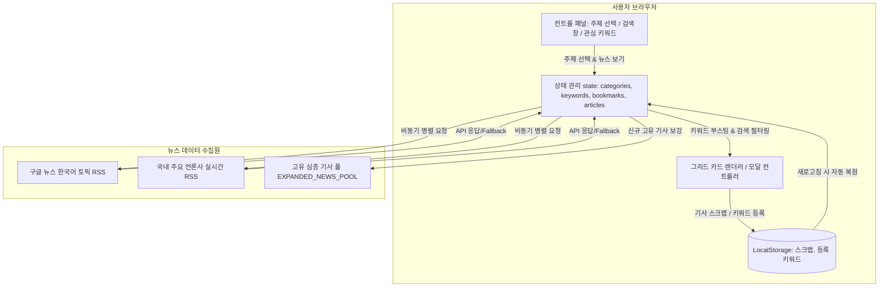

# 📰 맞춤형 스마트 뉴스 리더 웹 애플리케이션 명세서

## 1. 프로젝트 개요 (Project Overview)

### 1.1 프로젝트 명
- **맞춤형 스마트 뉴스 리더 (Personalized Smart News Reader)**

### 1.2 개발 배경 및 목적
- 정보 과잉 시대에 사용자가 원하는 관심 분야(비즈니스, 스포츠, 문화)의 뉴스를 선택적으로 소비할 수 있는 환경 제공
- 외부 실시간 오픈 뉴스 API를 연동하여 최신 헤드라인을 빠르게 탐색
- 사용자가 설정한 **개인 관심 키워드(예: 손흥민, AI, 반도체 등)**에 최적화된 기사 추천 및 하이라이트 제공
- 읽고 싶은 기사의 **원클릭 스크랩(북마크)** 및 본문 모달 뷰어 지원
- 순수 프론트엔드 표준 기술(**HTML5, Modern Vanilla JS, Pure CSS3**)만을 사용하여 별도의 복잡한 빌드/설치 과정 없이 가볍고 빠른 성능 보장

### 1.3 기술 스택
| 계층 | 기술 | 상세 설명 |
|---|---|---|
| **Structure** | HTML5 | 시맨틱 웹 표준 마크업, 접근성(ARIA) 준수 |
| **Styling** | Vanilla CSS3 | Flexbox, Responsive CSS Grid, CSS 변수(Custom Properties), 글래스모피즘 & 부드러운 다단계 섀도우 |
| **Logic** | Vanilla JavaScript (ES6+) | 비동기 Fetch API, Intersection Observer, Boost Scoring 알고리즘, LocalStorage 영속화 |
| **External API** | RSS-to-JSON & Google News / 국내 주요 언론사 RSS | 실시간 한국어 뉴스 토픽 피드 연동 |
| **Typography** | Pretendard & Outfit | 가독성 높은 모던 웹 폰트 |

---

## 2. 시스템 아키텍처 및 데이터 흐름



---

## 3. 기능 명세서 (Functional Specifications)

### 3.1 주제 선택 및 뉴스 로드
| 번호 | 기능명 | 설명 | 비고 |
|---|---|---|---|
| **F-1.1** | 카테고리 다중 선택 | `비즈니스(Business)`, `스포츠(Sports)`, `문화(Culture)` 주제를 체크박스 칩 형태로 다중 선택 가능 | 최소 1개 이상 선택 강제 |
| **F-1.2** | 뉴스 보기 실행 | '뉴스 보기' 버튼 클릭 시 선택한 각 주제별 상위 10개 이상의 최신 헤드라인을 수집하여 피드 초기화 및 배치 | 로딩 스피너 및 버튼 비활성화 상태 제공 |
| **F-1.3** | 다중 소스 수집 | 구글 뉴스 및 국내 언론사 피드를 병렬 Fetch로 수집하여 풍부한 기사 풀 확보 | 네트워크 실패 시 실감형 Mock 데이터 Fallback 작동 |

---

### 3.2 반응형 카드 그리드 및 카드 디자인
| 번호 | 기능명 | 설명 | 비고 |
|---|---|---|---|
| **F-2.1** | 반응형 레이아웃 | 모바일(1열), 태블릿(2열), 데스크톱(3열) 자동 조절 반응형 CSS Grid | 미디어 쿼리 기반 완벽 최적화 |
| **F-2.2** | 카드 디자인 시스템 | 순백색(`#FFFFFF`) 배경, 둥근 모서리(`18px`), 부드러운 다단계 그림자(`box-shadow`) 및 호버 시 살짝 떠오르는 마이크로 인터랙션 적용 | 프리미엄 감성 디자인 |
| **F-2.3** | 카드 구성 요소 | 썸네일 이미지, 카테고리 뱃지, 출처(언론사), 작성 시간, 제목(2줄 말줄임), 요약(3줄 말줄임), 스크랩 버튼, 읽기 버튼 | 필수 요구사항 충족 |
| **F-2.4** | 3중 이미지 폴백 | 외부 원본 이미지 실패 시 카테고리 대표 이미지로 대체, 이마저도 실패 시 브라우저 자체 인라인 SVG 배너로 렌더링 | 이미지 엑박/깨짐 현상 원천 차단 |

---

### 3.3 본문 상세 보기 (모달)
| 번호 | 기능명 | 설명 | 비고 |
|---|---|---|---|
| **F-3.1** | 기사 모달 팝업 | 카드 내 '읽기' 버튼 클릭 시 배경 블러(`backdrop-filter: blur(8px)`) 처리와 함께 기사 상세 모달 오픈 | 배경 스크롤 락(`overflow: hidden`) 적용 |
| **F-3.2** | 모달 내 정보 제공 | 고해상도 대표 이미지, 카테고리 뱃지, 언론사, 발행 시간, 전체 제목, 본문 전문 요약, 원문 링크 버튼 | 새 창 열기 링크 지원 |
| **F-3.3** | 모달 내 즉시 스크랩 | 모달 상단 우측 스크랩 버튼을 통해 읽는 도중 즉시 보관/해제 가능 | 카드 상태와 실시간 동기화 |
| **F-3.4** | 모달 닫기 지원 | 우측 상단 닫기(✕) 버튼, 모달 바깥 배경 클릭, 키보드 `ESC` 키 입력 지원 | 편리한 사용자 경험 |

---

### 3.4 무한 스크롤 (Infinite Scroll)
| 번호 | 기능명 | 설명 | 비고 |
|---|---|---|---|
| **F-4.1** | 하단 도달 감지 | 브라우저 표준 `Intersection Observer API`를 사용하여 피드 최하단 센티널(`scrollSentinel`) 요소 감지 | 스크롤 이벤트 리스너 대비 최적의 성능 |
| **F-4.2** | 10건 단위 추가 로드 | 하단 감지 시 기존 카드를 유지한 채 다음 10건의 기사만 하단에 덧붙여 렌더링 (`appendChild`) | 중복 반복 렌더링 방지 |
| **F-4.3** | 고유 기사 공급 & 중복 방지 | `Set` 기반 제목 중복 체크를 통해 이미 노출된 기사는 원천 배제하고, 부족 시 분야별 심층 기사 풀에서 고유 기사를 생성하여 무한 공급 | 끊김 없는 연속 탐색 지원 |

---

### 3.5 관심 키워드 등록 및 우선 추천 (Boost Scoring)
| 번호 | 기능명 | 설명 | 비고 |
|---|---|---|---|
| **F-5.1** | 키워드 등록 및 삭제 | 사용자가 원하는 단어(예: `손흥민`, `AI`, `투자`)를 입력하여 키워드 태그 칩 등록, 태그별 `✕` 버튼으로 삭제 | 입력 즉시 반영 |
| **F-5.2** | 가중치 기반 우선 정렬 | 기사 제목(+100점), 요약(+50점), 본문(+20점)에 등록 키워드가 포함될 경우 가중치 점수를 부여하여 **피드 최상단에 우선 배치** | Boost Scoring 알고리즘 |
| **F-5.3** | 관심 기사만 보기 토글 | 상단 토글 스위치 활성화 시, 등록된 키워드가 포함된 기사만 필터링하여 집중 보기 제공 | 키워드 삭제 시 자동 안전 해제 |
| **F-5.4** | 키워드 시각화 | 매칭된 카드는 보라색 `#키워드` 뱃지가 부착되고, 제목/요약 내 키워드가 보라색 하이라이트(`<mark>`)로 강조 표시됨 | 가독성 극대화 |

---

### 3.6 실시간 검색 및 기사 스크랩 (보관함)
| 번호 | 기능명 | 설명 | 비고 |
|---|---|---|---|
| **F-6.1** | 실시간 기사 검색 | 검색어 입력창에 단어 입력 시 디바운스(200ms)를 적용하여 제목 및 본문에 검색어가 포함된 기사를 실시간 필터링 | 원클릭 지우기(✕) 버튼 제공 |
| **F-6.2** | 검색어 하이라이트 | 검색된 단어는 기사 제목과 본문에서 노란색 하이라이트(`<mark>`)로 표시 | 시각적 강조 |
| **F-6.3** | 기사 스크랩 토글 | 카드 우측 상단 북마크 아이콘, 하단 스크랩 버튼, 모달 내 스크랩 버튼 클릭 시 상태 토글 | 활성화 시 황금색 별표 및 '스크랩됨' 표시 |
| **F-6.4** | 스크랩 보관함 뷰 | 상단 탭에서 `[★ 스크랩 보관함]` 선택 시 스크랩된 기사들만 모아보기 제공 | 실시간 카운트 뱃지 연동 |
| **F-6.5** | 브라우저 영속화 | 등록된 관심 키워드와 스크랩 목록은 `localStorage`에 자동 저장되어 새로고침 후에도 유지 | 영구 보관 지원 |

---

## 4. UI 컴포넌트 및 파일 구조

```
project9/
├── index.html        # 시맨틱 레이아웃, 컨트롤 패널, 카드 그리드, 모달 마크업
├── style.css         # 모던 디자인 시스템, 반응형 그리드, 카드 섀도우, 모달 블러 효과
├── app.js            # 데이터 수집, 키워드 부스팅, 무한 스크롤, 스크랩, 모달 로직
└── README.md         # 프로젝트 개요 및 기능 명세서 (본 문서)
```

---

## 5. 실행 및 브라우저 호환성

- **실행 방법**:
  1. 로컬 웹 서버 실행 (현재 `http://localhost:3000` 가동 중)
  2. 또는 [`index.html`](file:///c:/Users/천동수/Desktop/project9/index.html) 파일을 Chrome, Edge, Safari 등 최신 웹 브라우저에서 직접 열기
- **브라우저 호환성**: Modern Chrome, MS Edge, Safari, Firefox 전 기종 호환
- **외부 종속성**: 외부 라이브러리(Node/Webpack 등)에 의존하지 않는 100% Native Web Standards 기반
